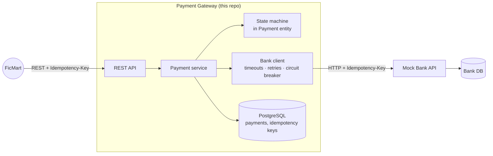
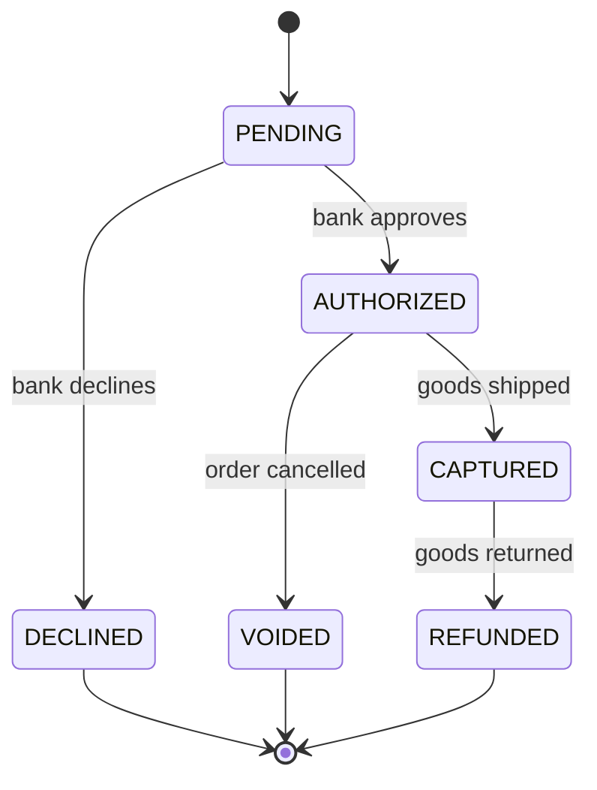

# Payment Gateway

A fault-tolerant payment gateway built with **Java and Spring Boot**. It sits between an e-commerce platform and a deliberately unreliable bank, and makes sure a customer is **never charged twice**, even when the bank fails, times out or the gateway itself crashes mid-transaction.

> 🚧 **Work in progress.** See the [roadmap](#roadmap) for what is done and what is next.

Built as part of the [Backend Engineer Path](https://github.com/benx421/backend-engineer-path) ([project spec](https://github.com/benx421/payment-gateway)).

---

## The problem

FicMart, a fictional online shop, needs to take payments:

| FicMart event | Gateway operation | What happens to the money |
|---|---|---|
| Order placed | **Authorize** | Funds are reserved on the card |
| Goods shipped | **Capture** | Reserved funds are actually taken |
| Order cancelled before shipping | **Void** | The reservation is released |
| Goods returned | **Refund** | Captured money goes back to the customer |

The bank behind the gateway behaves like a real one on a bad day:

- **~5% of requests fail randomly** with HTTP 500
- **100–2000 ms of latency** on every call
- **Strict state rules** (an authorization can be used only once)
- Authorizations **expire after 7 days**

The gateway's job: *the bank will fail, but the gateway must not.*

---

## Architecture



The gateway keeps its **own** database of payment receipts. It is the source of truth for FicMart, independent of the bank's records.

---

## Payment lifecycle



Any other transition (for example voiding a captured payment) is rejected by the gateway **before** the bank is ever called.

---

## Key design decisions

**State machine inside the domain model.**
Transition rules live in one place (`PaymentStatus.canTransitionTo`). The `Payment` entity exposes intention-revealing methods (`authorize`, `capture`, `voidPayment`, `refund`, `decline`) instead of setters, so an invalid state can't be created from anywhere in the code. A failed transition leaves the payment untouched.

**Optimistic locking against double capture.**
`Payment` carries a `@Version` column. If two requests load the same payment and both try to capture it, the second write is rejected (`WHERE version = ?` matches no rows). This is covered by a test that reproduces the race step by step.

**Database-enforced invariants.**
The schema doesn't rely on application code alone:
- `CHECK` constraints for valid statuses and positive amounts
- a **partial unique index** guaranteeing at most one non-declined payment per order, while still allowing a declined attempt to be retried with another card

**Money as integer cents.**
Amounts are stored as `BIGINT` cents, never as floating point, to avoid rounding errors.

**No card numbers stored.**
Only the last 4 digits are kept, which keeps the database out of scope for sensitive card data.

**Schema owned by Flyway.**
Hibernate runs with `ddl-auto: validate`: it checks the entities against the schema but never changes it. Every change is a versioned migration.

---

## Tech stack

| Area | Technology |
|---|---|
| Language | Java 25 |
| Framework | Spring Boot 4 (Web MVC, Data JPA, Validation, Actuator) |
| Database | PostgreSQL 16, Flyway migrations |
| Testing | JUnit 5, AssertJ, Spring Boot Test, Testcontainers |
| Local environment | Docker Compose |
| Planned | Resilience4j, Spring Security, springdoc-openapi |

---

## Getting started

### Prerequisites

- JDK 25
- Docker Desktop (or Docker Engine with the Compose plugin)

### 1. Start the mock bank

The bank lives in a separate repository:

```bash
git clone --config core.autocrlf=false https://github.com/benx421/payment-gateway.git mock-bank
cd mock-bank/docker
docker compose up --build -d
```

Bank API: `http://localhost:8787` · Swagger UI: `http://localhost:8787/docs`

> On Windows, `core.autocrlf=false` keeps the bank's shell scripts with Unix line endings. Without it, the bank container fails to start.

### 2. Start the gateway database

From this repository:

```bash
docker compose up -d
```

PostgreSQL runs on **port 5433**, so it doesn't clash with the bank's database on 5432.

### 3. Run the gateway

```bash
./mvnw spring-boot:run        # Windows: .\mvnw.cmd spring-boot:run
```

Health check: `http://localhost:8080/actuator/health`

### Configuration

All database settings can be overridden with environment variables:

| Variable | Default |
|---|---|
| `GATEWAY_DB_HOST` | `localhost` |
| `GATEWAY_DB_PORT` | `5433` |
| `GATEWAY_DB_NAME` | `gateway` |
| `GATEWAY_DB_USER` | `gateway` |
| `GATEWAY_DB_PASSWORD` | `gateway` |

---

## Testing

```bash
./mvnw clean verify            # Windows: .\mvnw.cmd clean verify
```

Docker must be running: integration tests start a throwaway PostgreSQL container with **Testcontainers**, so they never touch the local database.

| Test class | Type | What it proves |
|---|---|---|
| `PaymentStatusTests` | Unit | All 36 state transitions (parameterized) |
| `PaymentTests` | Unit | Transitions update the payment correctly; failed ones change nothing |
| `PaymentRepositoryTests` | Integration (real Postgres) | Persistence round-trip, active-payment lookup, optimistic locking under a simulated race |
| `HealthEndpointTests` | Integration | The app starts and reports the database as UP |

---

## Project structure

```
src/main/java/com/adrianalexandru/payment_gateway/
├── PaymentGatewayApplication.java
└── payment/                     # package-by-feature
    ├── Payment.java             # entity + state transitions
    ├── PaymentStatus.java       # states and transition rules
    └── PaymentRepository.java   # Spring Data queries
src/main/resources/
├── application.yml
└── db/migration/                # Flyway migrations
docs/
└── bank-notes.md                # observed behaviour of the mock bank
```

---

## Roadmap

- [x] Project setup: Docker Compose, Flyway, Actuator, Testcontainers
- [x] Mock bank exploration and error classification ([notes](docs/bank-notes.md))
- [x] Payments schema, entity and repository
- [x] State machine with optimistic locking
- [ ] Idempotency keys on the gateway API
- [ ] Bank client: timeouts, retries on transient errors, circuit breaker
- [ ] Crash recovery and reconciliation with the bank
- [ ] REST API, API-key authentication, Problem Details errors, OpenAPI docs
- [ ] Metrics, request-ID logging, containerised gateway
- [ ] `TRADEOFFS.md`
